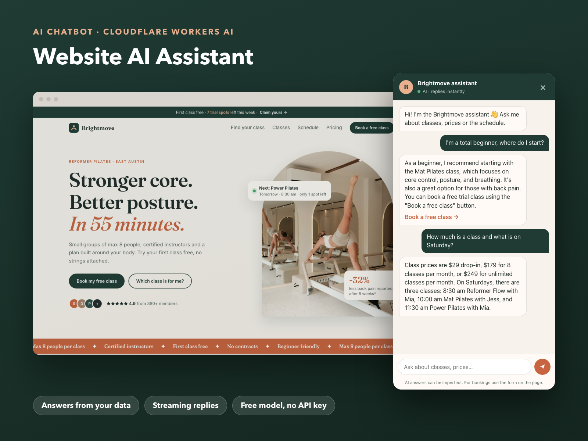

# Brightmove AI Assistant — Website Chatbot

An AI chat assistant for a small business website. It answers visitors' questions about classes, prices, schedule and policies **only from the business's own knowledge base**, and nudges interested visitors to book a free trial.

**Live demo:** open https://woaquw.github.io/brightmove-studio/ and click the chat bubble in the bottom-right corner.



## How it works

```
Website widget (chat.js)  →  Cloudflare Worker (/chat)  →  Workers AI (Llama 3.3 70B)
        ↑  streamed answer (Server-Sent Events)  ←
```

- **Widget** (in the [landing page repo](https://github.com/woaquw/brightmove-studio): `chat.js`, `chat.css`): floating button, suggested questions, typing indicator, answer streamed word by word, "Book a free class" button when the bot suggests booking, mobile full-screen layout, friendly fallback if the service is down.
- **Worker** (`src/index.ts`): validates and trims the conversation, adds the system prompt with the business facts, calls the model and streams the reply back.
- **Knowledge base** (`src/knowledge.ts`): plain text with the studio's facts. Reusing the bot for another business means editing this one file.

## Safety and cost control

- The model runs on **Cloudflare Workers AI's free daily allowance**: no API key, no card. If the allowance runs out, the widget shows a friendly fallback until the next day.
- **No secrets in the browser:** the website only knows the Worker URL.
- **Origin allow-list:** only the studio website (and localhost) can call the Worker, so other sites can't use up the quota.
- **Limits:** last 12 messages, 600 characters per message, 350 tokens per answer.
- **Guardrails in the prompt:** answer only from the facts, say "not sure" instead of guessing, no invented prices or discounts, no medical advice, stay on topic, ignore "ignore your instructions" requests. Replies in the visitor's language.

Tested examples: price and schedule questions (correct facts), "I'm a beginner, where do I start?" (recommends Mat Pilates and the free class), an off-topic coding request (politely declined), a fake discount request (refused), a question in Russian (answered in Russian, unknown parking info → "not sure, please call").

## Switching the model

The model is set in `wrangler.jsonc` (`MODEL`). Any Workers AI text model works. For a paid model (Claude, GPT), replace the `env.AI.run` call with a call to that provider's API and store the key with `wrangler secret put` — it never reaches the browser.

## Run and deploy

```bash
npm install
npx wrangler login
npm run dev      # local worker
npm run deploy   # publish to <name>.workers.dev
```

The studio and its facts are fictional; this is a portfolio project.
